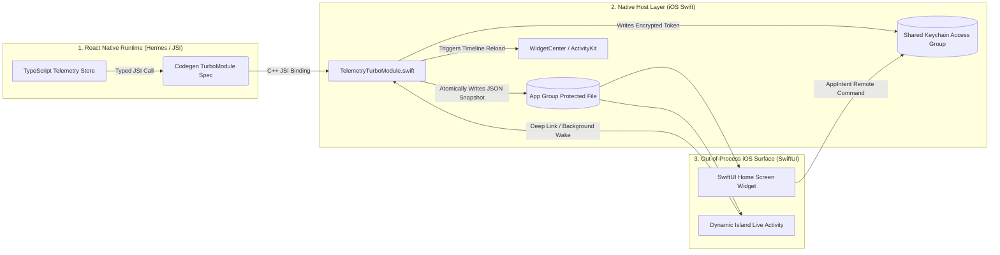
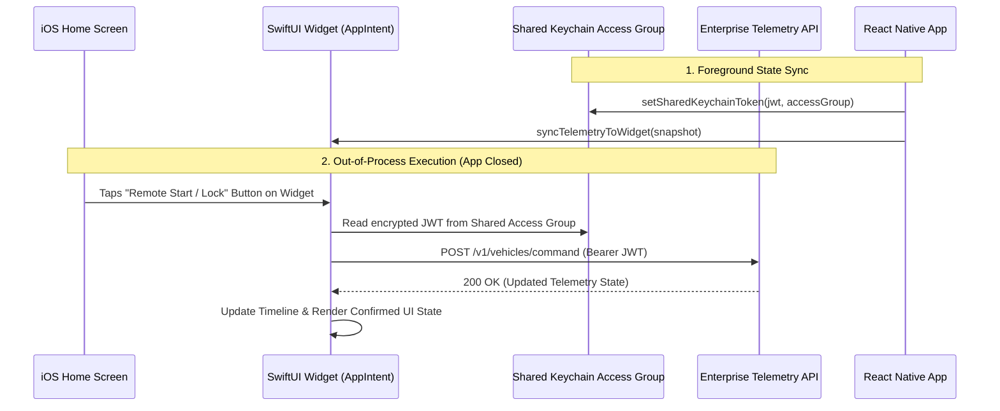

# React Native New Architecture & SwiftUI Widget Bridge

[](https://www.typescriptlang.org/)
[](https://reactnative.dev/docs/the-new-architecture/landing-page)
[](https://developer.apple.com/xcode/swiftui/)

A production-oriented reference library bridging **React Native (TypeScript)** with **native iOS SwiftUI Home Screen Widgets, Live Activities (Dynamic Island), and shared Keychain storage** using **New Architecture Codegen TurboModules (JSI)**. It is an iOS library, not a standalone signed application; integration requires a host app and Widget Extension targets.

Designed for connected-vehicle telemetry and similar native surfaces where bounded JS work and independent extension execution matter.

Designed and maintained by **[Julian Khatibi](https://www.khatibi.app/)**.

---

## The Architectural Problem

In enterprise brownfield and high-scale consumer apps (such as connected vehicle ecosystems or real-time healthcare/logistics platforms), standard JavaScript-only React Native hits three hard walls:
1. **Out-of-Process OS Surfaces:** iOS `WidgetKit` (Home Screen Widgets) and `ActivityKit` (Lock Screen Live Activities / Dynamic Island) run in separate OS extension processes and cannot execute a React Native JS bundle.
2. **Legacy Asynchronous Bridge Serialization:** Passing high-frequency telemetry or biometric tokens over the legacy JSON bridge introduces serialization overhead and frame drops.
3. **Cross-Process Secure State Sharing:** Sharing authenticated session tokens and telemetry between the main React Native runtime and native SwiftUI extensions requires **App Group Shared Containers** and **Keychain Access Groups**.

---

## System Architecture & Native Bridge Flow



---

## Key Engineering Highlights

### 1. Strongly-Typed Codegen TurboModule Contract
Uses React Native's **Codegen** (`src/specs/NativeTelemetryBridge.ts`) to generate C++/Objective-C++ interfaces. The Objective-C++ adapter implements the generated protocol and constructs its JSI module; it is not a legacy `RCT_EXTERN_MODULE` shim. Only `setSharedKeychainToken` is synchronous; persistence and ActivityKit operations return promises and do not block JS on file I/O.

### 2. Atomic Shared App Group State Synchronization
When the React Native client receives updated vehicle/device telemetry (e.g., EV battery state, remote lock status, or clinical shift status), the TurboModule atomically:
- Persists one complete JSON payload into **`group.com.khatibi.enterprise.telemetry`**, using a cross-process file lock, atomic replacement, and iOS file protection.
- Rejects older snapshots and conflicting equal-timestamp snapshots; identical snapshots are idempotent.
- Requests `WidgetCenter.shared.reloadTimelines(ofKind:)`. The OS controls the actual refresh schedule and budgets; immediate rendering is not guaranteed.

### 3. Interactive SwiftUI Widgets (`AppIntents`) & Secure Keychain Sharing
Supports iOS 17+ interactive widget commands. The extension reads a short-lived bearer token from the configured **Keychain Access Group**, requires device authentication, confirms unlock commands, and posts directly to a trusted HTTPS backend without JS. Redirects, cookies, and caching are disabled. The UI changes only after a validated server response. Keychain generic-password items are protected by iOS; this does not create Secure Enclave keys or provide application-level encryption of the snapshot.

---

## Project Structure

```text
rn-swiftui-turbo-bridge/
├── src/
│   ├── specs/
│   │   └── NativeTelemetryBridge.ts      # Codegen TurboModule TypeScript specification
│   ├── services/
│   │   └── WidgetSyncService.ts          # High-level TS orchestrator with error boundaries
│   └── hooks/
│       └── useLiveActivityTelemetry.ts   # React hook managing Dynamic Island lifecycle
├── ios/
│   ├── Bridge/
│   │   └── TelemetryTurboModule.swift    # Native Swift implementation & Keychain sync
│   └── TelemetryWidgetExtension/
│       ├── TelemetryWidget.swift         # SwiftUI Home Screen Widget & TimelineProvider
│       └── RemoteCommandIntent.swift     # iOS Interactive AppIntent handler
├── __tests__/
│   └── WidgetSyncService.test.ts         # Jest unit tests with mocked TurboModule JSI bindings
└── README.md
```

---

## Interactive Widget Command Sequence



---

## Install and validate

Requires Node 22.13+ (or a Node version supported by React Native 0.85), React 19.2.3, and React Native 0.85 with the New Architecture. The iOS deployment minimum is 16.2; interactive widget controls require iOS 17.

```sh
npm ci
npm run typecheck
npm run codegen
npm test -- --coverage
```

`npm run codegen` checks the actual native contract without requiring an Xcode host project; artifacts are placed in `/tmp/telemetry-codegen`. A consuming application's CocoaPods installation generates its own artifacts. CI also runs strict SwiftLint and typechecks shared/extension sources against the iOS simulator SDK on macOS. Full host/adapter compilation, signing, device Keychain behavior, and ActivityKit authorization require the integrated Xcode targets; Jest mocks do not validate these.

## Host app and Widget Extension integration

1. Add this package to an iOS React Native host, run its normal CocoaPods autolinking/installation, and enable the New Architecture. `TelemetryBridge.podspec` compiles the requested `.m` adapter as **Objective-C++**; do not compile that file as plain Objective-C.
2. Create a Widget Extension target. Add every `ios/Shared/*.swift` and `ios/TelemetryWidgetExtension/*.swift` source to it, but **not** `ios/Bridge/` or React Native. The host gets the bridge/shared sources from the pod. Use the supplied `TelemetryWidgetBundle` as the extension's only `@main` entry point.
3. Enable App Groups and Keychain Sharing on **both** targets with the same provisioned values. Add the App Group entitlement `group.com.khatibi.enterprise.telemetry` and a Keychain access group such as `$(AppIdentifierPrefix)com.yourcompany.telemetry`. Replace the latter with your team's provisioned suffix, not an arbitrary runtime group.
4. On **both** targets, set `TelemetryAppGroup` in Info.plist to `group.com.khatibi.enterprise.telemetry`, and `TelemetryKeychainAccessGroup` to that same, build-expanded Keychain access group. On the extension, set `TelemetryCommandBaseURL` to your backend's HTTPS base URL (no user info, query, fragment, or non-443 port). Missing configuration fails closed; no sample endpoint or credentials are shipped.
5. Set `NSSupportsLiveActivities` to `YES` in the host Info.plist. Include the Live Activity widget from the supplied bundle. The host must be foregrounded when starting an activity; OS authorization, device capability, and activity limits still apply.

The widget requires a real snapshot before it exposes commands. Data uses Unix epoch **milliseconds**, safe integer timestamps, nonempty IDs/names of at most 256 UTF-16 code units (no C0/C1 control characters), and a finite percentage in `[0, 100]`. The backend accepts `POST <base>/v1/vehicles/command` with JSON `entityId` and `command` (`LOCK`, `UNLOCK`, or `START_CLIMATE`), bearer authentication, and an `Idempotency-Key`. It must authenticate and authorize the entity/action, enforce expiry and replay protection, honor idempotency, and return **200 application/json** containing a complete `TelemetrySnapshot` with a strictly newer timestamp and confirmed lock state. `202 Accepted` is not treated as confirmed telemetry. Concurrent entity changes or newer writes prevent stale command responses from overwriting the active snapshot.

`setSharedKeychainToken(token, accessGroup)` returns `false` on failure and accepts only the native-configured group. Pass an empty token to delete it at logout; stop activities with `endAllLiveActivities()` as well. Tokens use `AfterFirstUnlockThisDeviceOnly` accessibility so background commands work after first device unlock; they are not available before first unlock after reboot. Use short-lived, narrowly scoped tokens and never put them in snapshots or logs.

## JavaScript lifecycle and batching

- `widgetSyncService.syncTelemetryToWidget(snapshot)` validates and copies input, coalesces adjacent pending updates for the same entity, and serializes native writes. Every coalesced caller receives the selected batch's result, not a guarantee its individual snapshot was written. Entity switches remain FIFO. `false` means native storage rejected a stale/conflicting snapshot.
- The default queue bounds **callers**, including coalesced and in-flight requests, to 256. Overflow and native errors reject with sanitized `WidgetSyncError` codes. Failed batches do not poison the queue. `flush()` waits for the next idle point; it does not swallow individual request rejections.
- This is a JS scheduling queue, **not** an iOS background execution entitlement or persistent job queue. Widget AppIntents execute entirely natively.
- Mount `useLiveActivityTelemetry(snapshot, enabled)` once at the session root. It updates in place, replaces activities when the entity changes, exposes `activityId`/`error`, ignores late results, serializes cleanup/start across mounts, and ends all activities on disable/unmount. Additional simultaneous owners are rejected because the native end API is app-wide. React cleanup is best effort; force-quit/crash termination requires host/server lifecycle policies or ActivityKit push updates, which this local-only bridge does not implement.

---

## Author

**Julian Khatibi**  
Staff / Lead Mobile Architect (React Native, TypeScript, iOS/Android)  
[Portfolio (khatibi.app)](https://www.khatibi.app/) • [LinkedIn](https://www.linkedin.com/in/ajkhatibi/) • [Medium](https://medium.com/@ajkhatibi)
